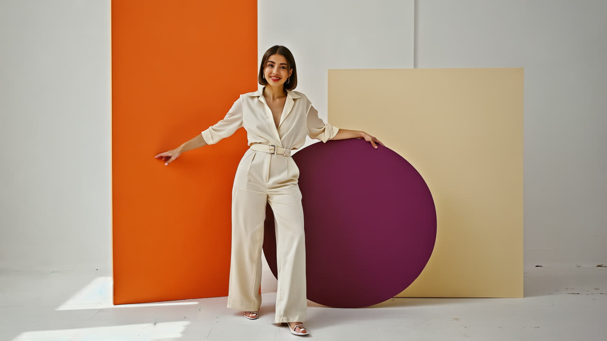
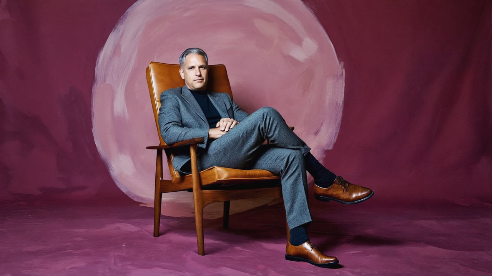
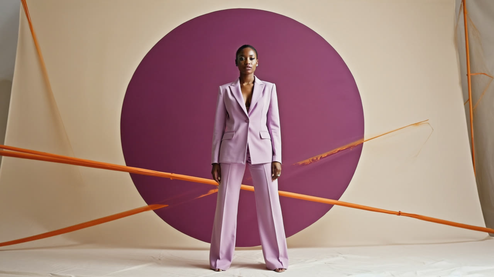
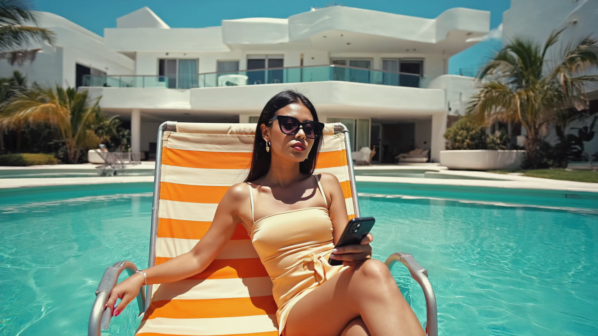
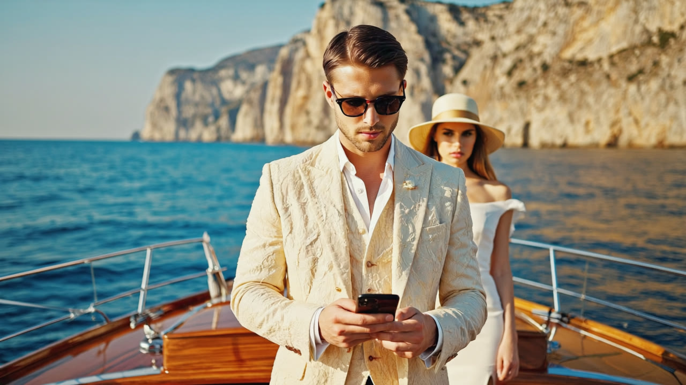
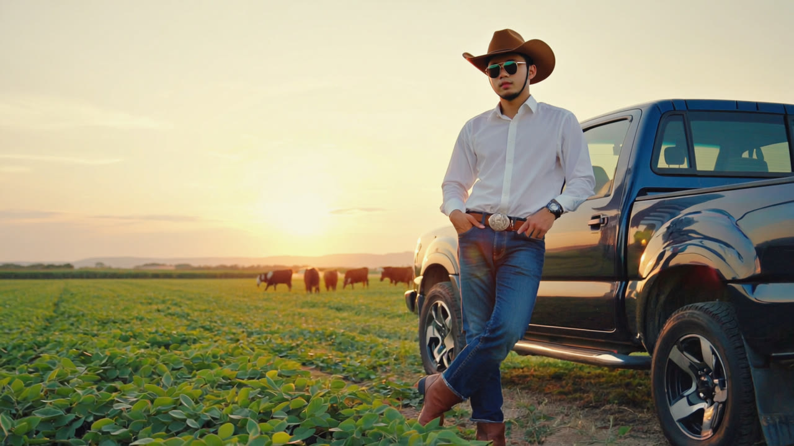
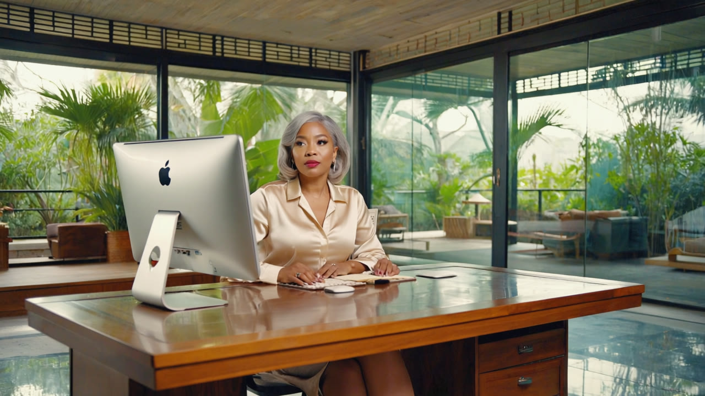
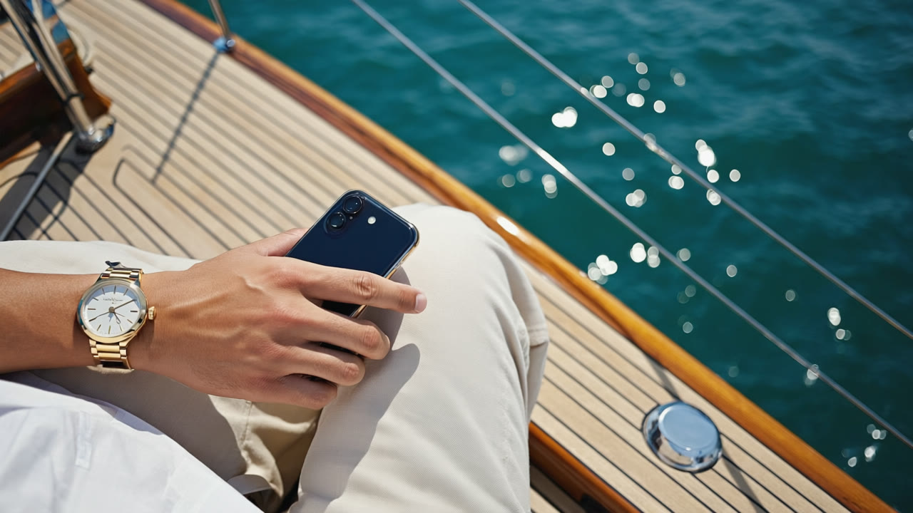

# Direção visual e personagens

Editorial de moda, perfume e alta-costura com colagem Bauhaus: uma imagem forte, presença adulta, cenário desejável e poucas palavras. O produto dá a prova. Luxo calmo, ensolarado e preciso; nada de confete, pressa, euforia ou escritório genérico cinza.

## Sistema visual fixo

| Elemento | Regra da temporada |
|---|---|
| Roxo | `#734B9C` |
| Laranja | `#F18A43` |
| Papel | `#F6F3EE` |
| Profundo | `#35213F` |
| Tinta do job 01 | `#1A1D23` |
| Amarelo | `#FDC234`, só no ponto do logo ou em objeto pequeno. Não usar como forma grande sem nova orientação. |
| Títulos | Inter Light 300, entrelinha 1, tracking −0,035 em, sem serifa e sem itálico, quebras por sentido. |
| Rótulos | JetBrains Mono, caixa alta, espaçamento ~0,26 em. |
| Marca | PNGs oficiais recortados em `assets/marca/`; roxo com ponto amarelo no claro, branco no profundo. Não redigitar a marca. |
| Quadro horizontal | Referência 1600×900, exportação 1920×1080, 30 fps. |
| Quadro vertical | Composição própria 1080×1920, exportação 1080×1920, 30 fps. Não cortar automaticamente o horizontal. |

Esses são os tokens específicos aprovados para os vídeos. Não importar automaticamente o laranja/papel ou o título pesado da identidade transitória de outro relatório. Roxo e laranja aparecem em objetos, roupa e formas; não aplicar filtro roxo sobre toda a fotografia.

## Fotografia, cenário e direção

Médio formato, cor de referência de meados do século XX, nitidez e grão fino. Estúdio pintado com luz lateral de pintor e spotlight suave. Piscina e mar com sol e sombras claras. Campo na hora dourada. Casa modernista com madeira, vidro e luz de janela. Manter a luz da fotografia em vez de uniformizar tudo num filtro.

Adultos fictícios brasileiros, com diversidade e elegância sem ostentação. Alfaiataria, linho, seda, tons claros/terrosos, óculos grandes quando presentes na referência. O gesto se volta para a composição: construir, apresentar, acompanhar. Não andar para fora, virar as costas, empurrar o produto para longe ou simular fuga.

Não acrescentar texto ou logo dentro da imagem gerada. Marca e mensagem entram como camadas do gerador. Sem champagne, cédulas ou exposição gratuita de riqueza. Não acrescentar logos de roupas, veículos ou dispositivos; o monitor de c8 já contém uma marca e precisa de reenquadramento para a peça pública.

## Continuidade de identidade

Estas fotografias são referências existentes, não uma bíblia de rostos em vários ângulos. Usar o arquivo correto como quadro inicial de image-to-video. Preservar rosto, idade aparente, cabelo, pele, roupa, acessórios, proporções, cenário e direção de luz de cada referência. Um prompt descritivo sozinho não fixa identidade. Conferir visualmente o resultado; nenhuma ferramenta garante continuidade perfeita.

Não tratar pessoas de imagens distintas como a mesma atriz. A mulher c3 e a executiva c8 são referências diferentes. “Helena” num app de demonstração é uma identidade sintética de interface, não prova de que a atriz de outro quadro seja essa personagem. Sem ângulos adicionais ou fotos de corpo inteiro inventados como se já existissem.

Variação desejada: composição, máscara, recorte, posição, relação entre cenário e prova e um gesto breve. O elenco não troca de rosto ou figurino em cada episódio. A variação local não precisa de uma geração nova.

## A criadora · `criadora`

Referência: `assets/personagens/c7b-criadora.jpg`. Papel: **Protagonista de construção**.

Macacão creme, cabelo escuro, sorriso, mão apoiada no círculo roxo e mão livre apresentando. Usar c7b; c7 séria é versão anterior.

Atuação: Respiração, olhar para o espectador, sorriso discreto e um pequeno gesto da mão que já está livre. A mão apoiada conserva o contato.

## O executivo · `executivo`

Referência: `assets/personagens/c1-executivo.jpg`. Papel: **Comprador / responsável pelo crédito**.

Homem maduro sentado, alfaiataria e poltrona, fundo pintado profundo. A fotografia prevalece sobre a descrição antiga de terno grafite.

Atuação: Uma respiração e um pequeno movimento de olhar, encerrando com expressão segura. Manter mãos e corpo apoiados.

## A diretora do círculo · `diretora`

Referência: `assets/personagens/c3-circulo.jpg`. Papel: **Compradora / configuração e revisão**.

Mulher negra, alfaiataria lilás, círculo roxo e linhas laranja. Não confundir com a mulher do escritório.

Atuação: Pequena mudança do olhar e sorriso contido; mesma pose e eixo do corpo. Formas do estúdio imóveis.

## A mulher da piscina · `piscina`

Referência: `assets/personagens/c2-piscina.jpg`. Papel: **Vitrine do cliente da instituição**.

Óculos grandes, roupa clara, cadeira listrada, piscina modernista. Não virar protagonista de oferta de conta para pessoa física.

Atuação: Respiração, brisa mínima e reflexo suave da água. Preservar óculos; não inventar telefone ou retirar acessórios.

## O casal do iate · `iate`

Referência: `assets/personagens/c4-iate.jpg`. Papel: **Vitrine de experiência e patrimônio**.

Casal adulto, linho creme e seda branca, óculos/chapéu, barco de madeira e mar. Preservar a orientação construtiva do recorte.

Atuação: Leve troca de olhar e brisa discreta, sem deslocamento ou manobra do barco.

## Diego · agro executivo fictício · `agro`

Referência: `assets/personagens/c6-agro.jpg`. Papel: **Cliente / ativo em garantia, com decisor abrindo e fechando**.

Camisa branca, chapéu, jeans e caminhonete, campo na hora dourada. Nome editorial fictício; nunca cliente real ou depoimento.

Atuação: Pequeno movimento de olhar e respiração. Não fazer pegar telefone, conduzir veículo ou gesticular com animais.

## A executiva do escritório · `escritorio`

Referência: `assets/personagens/c8-desktop.jpg`. Papel: **Operação / mesa de trabalho**.

Mulher com cabelo grisalho, blusa creme, mesa de madeira e casa envidraçada. É outra referência de rosto, não a diretora c3. Há logotipo Apple no monitor: reenquadrar para tirá-lo da peça pública.

Atuação: Pequeno olhar da área de trabalho para a composição, mãos em repouso. Não animar digitação nem fabricar conteúdo na tela.

## Pipa e dunas · `kite`

Referência: `assets/personagens/c5-kite.jpg`. Papel: **Motivo de conexão / paisagem**.

Mar turquesa, dunas e pipa nas cores da marca. Não é personagem recorrente nem prova de integração.

Atuação: Brisa e oscilação mínima da pipa; manter horizonte e câmera fixos.

## Mão / assinatura editorial · `detalhe`

Referência: `assets/personagens/c9-assinatura.jpg`. Papel: **Detalhe ilustrativo**.

Detalhe de mão e dispositivo no cenário do iate. O nome do arquivo não comprova assinatura de documento.

Atuação: Mínima respiração da mão sem novo toque ou conteúdo; documento e assinatura só por captura real.

## A médica · referência ausente

A direção original descreve Helena, médica fictícia no fim dos 30, jaleco e poltrona modernista em estúdio creme. Nenhuma imagem canônica correspondente foi localizada neste kit. A descrição não é um asset pronto. Nos episódios 27–30, executivo e diretora podem conduzir a história com capturas genéricas de fonte, operação e conta. A atriz médica não é obrigatória para concluir a versão local sem despesa; não usar a mulher da piscina como médica ou gerar outra sem registrar a decisão.

## Referências antigas e reutilização

`c7-criadora.jpg` é a expressão anterior; usar c7b sorrindo. As fusões em `../fusao/` mostram a composição, mas podem conter telas antigas vetadas e não são prova automaticamente liberada. B2 é vitrine; BK1 e CR1 antigos também exigem revisão das telas. Não baixar imagens novas como atalho para substituir o elenco.
